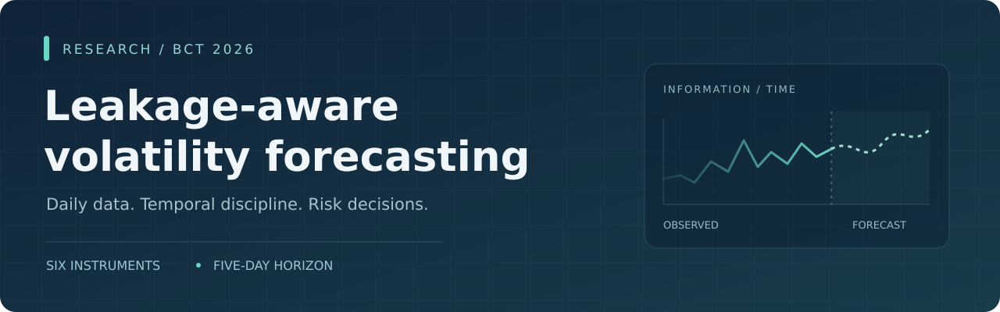
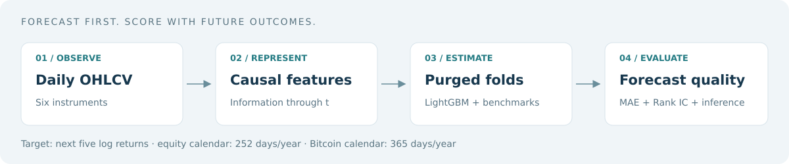

<p align="center">
  
</p>

<p align="center">
  <a href="https://doi.org/10.56632/bct.2026.5201"></a>
  <a href="https://github.com/alimohamad2005/leakage-aware-volatility-forecasting/actions/workflows/quality.yml"></a>
  
  <a href="LICENSE"></a>
  
</p>

# Leakage-Aware Volatility Forecasting for Business Risk Management

**Research companion · Journal of Business, Communication & Technology · 2026**

Daily market observations become five-day volatility forecasts, evaluated with temporal separation and two established benchmarks. This repository brings together the article reference, published summary tables, a preserved historical code snapshot, and a tested public reconstruction.

[Read the article](https://www.bctjournal.com/article_652.html) · [فارسی](README.fa.md) · [Run the code](#quick-start) · [Reproducibility status](docs/REPRODUCIBILITY.md) · [Cite](#citation)

> **Evidence status:** The historical snapshot contains code and output schemas, but no populated original predictions or fold results. The published numbers below are labeled as reported. The public reconstruction is tested on synthetic data; an exact reproduction of the original experiment remains pending.

## The study at a glance

| Instruments | Forecast target | Core comparison | Evaluation |
| :--- | :--- | :--- | :--- |
| SPY, AAPL, MSFT, GOOGL, AMZN, BTC-USD | Next five log returns, annualized sample volatility | LightGBM · GARCH(1,1) · Persistence | Purged rolling walk-forward |

The research connects forecast quality to a proposed risk-budget decision rule. Its business outcomes remain future work; forecast accuracy alone does not establish profitability or improved investment performance.

<p align="center"></p>

## Results reported in the article

| Asset | Mean Rank IC | LightGBM MAE | GARCH MAE | Persistence MAE |
| :--- | ---: | ---: | ---: | ---: |
| SPY | +0.328 | 0.0596 | 0.1428 | 0.0896 |
| AAPL | +0.185 | 0.1005 | 0.2447 | 0.1367 |
| MSFT | +0.095 | 0.0957 | 0.2314 | 0.1409 |
| GOOGL | +0.086 | 0.1046 | 0.2483 | 0.1586 |
| AMZN | +0.175 | 0.1079 | 0.2738 | 0.1514 |
| BTC-USD | +0.110 | 0.2088 | 0.4503 | 0.2935 |

The article reports equal-asset average MAE reductions of **58.0% against GARCH** and **30.6% against persistence**, with a mean Rank IC of **+0.163**. These summaries are not independently reproduced here. Sources: article Tables 6–8; machine-readable values in [`reported/paper_metrics.csv`](reported/paper_metrics.csv).

## Quick start

Use Python 3.11 or 3.12. Run commands from the repository root.

```bash
git clone https://github.com/alimohamad2005/leakage-aware-volatility-forecasting.git
cd leakage-aware-volatility-forecasting
python -m venv .venv
```

Activate the environment:

| System | Command |
| :--- | :--- |
| Windows PowerShell | `.venv\Scripts\Activate.ps1` |
| Windows Command Prompt | `.venv\Scripts\activate.bat` |
| macOS / Linux | `source .venv/bin/activate` |

```bash
python -m pip install -r requirements.txt
python -m unittest discover -s tests -v
python tools/audit_reported_results.py
```

**Try the complete three-model flow without downloading market data:**

```bash
python tools/smoke_run.py
```

This creates synthetic bars and results under `tmp/smoke/`. Synthetic values validate software behavior and are never presented as article results.

**Run a new market-data experiment:**

Place the six CSVs described in [`data/README.md`](data/README.md) under `data/`, then run:

```bash
python run_reproduction.py --config config.json --output outputs/reconstruction
python analyze_outputs.py --input outputs/reconstruction --reps 10000
```

Alternatively, add `--download` to the first command to fetch current vendor data. Downloaded history can differ from the article's original data. [Method and output details →](docs/METHOD.md)

## What is included

| Location | Purpose |
| :--- | :--- |
| [`run_reproduction.py`](run_reproduction.py), [`features.py`](features.py) | Current three-model reconstruction and 36 causal daily-bar features |
| [`config.json`](config.json) | Six-asset configuration; 756 / 63 / 21 windows and five-observation purge |
| [`analyze_outputs.py`](analyze_outputs.py) | Newey–West IC inference and stationary-bootstrap Hansen SPA comparisons for new runs |
| [`reported/`](reported/) | Clearly labeled published aggregate values |
| [`archive/2026-08-27/`](archive/2026-08-27/) | Unmodified 14-file historical snapshot, including empty output schemas |
| [`docs/`](docs/) | Article details, provenance, method, and reproducibility status |
| [`tests/`](tests/) | Causality, label support, purging, validation, and synthetic integration tests |
| [`MANIFEST.sha256`](MANIFEST.sha256) | Integrity inventory for this public package |

## Authors and citation

**Seyed Reza Javadzadeh · Ali Mohammad Siahkarzadeh · Pouria Parhami · Soroosh Babaee Khobdeh · Faezeh Rohani · Andreas Mueller**

### Citation

```bibtex
@article{javadzadeh2026leakage,
  title   = {Leakage-Aware Volatility Forecasting for Business Risk Management},
  author  = {Javadzadeh, Seyed Reza and Siahkarzadeh, Ali Mohammad and
             Parhami, Pouria and Babaee Khobdeh, Soroosh and
             Rohani, Faezeh and Mueller, Andreas},
  journal = {Journal of Business, Communication & Technology},
  year    = {2026},
  volume  = {5},
  number  = {2},
  pages   = {1--18},
  doi     = {10.56632/bct.2026.5201}
}
```

The repository's **Cite this repository** control uses [`CITATION.cff`](CITATION.cff), with the published paper as the preferred citation. [Article details and affiliations →](docs/ARTICLE.md)

## License and contact

Software is distributed under the existing [MIT license](LICENSE). Market data retain their providers' terms; the article has its own publisher license. The article PDF and manuscript sources are linked through the journal rather than bundled here.

Repository maintainer: **Ali Mohammad Siahkarzadeh** · [GitHub](https://github.com/alimohamad2005) · [alimohamad2005@gmail.com](mailto:alimohamad2005@gmail.com). For reproducibility questions, [open an issue](https://github.com/alimohamad2005/leakage-aware-volatility-forecasting/issues/new/choose).
